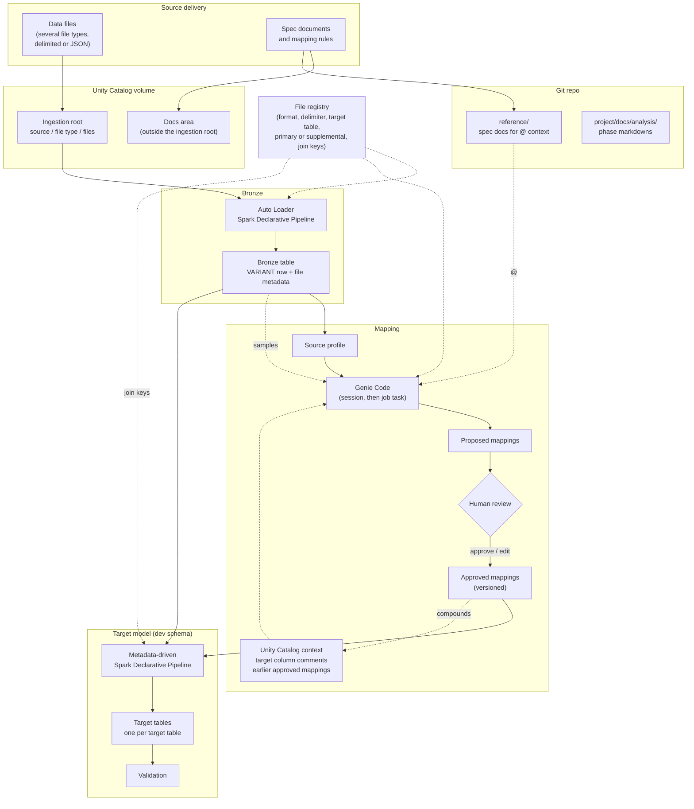

# End-to-End Flow

**Reading the diagram**
- Solid arrows are data flow; dotted arrows are context or configuration.
- Genie Code writes only to *Proposed mappings*. Only *Approved mappings* reach the pipeline.
- Approved mappings feed back into the context for the next source, which is how onboarding gets faster over time.
